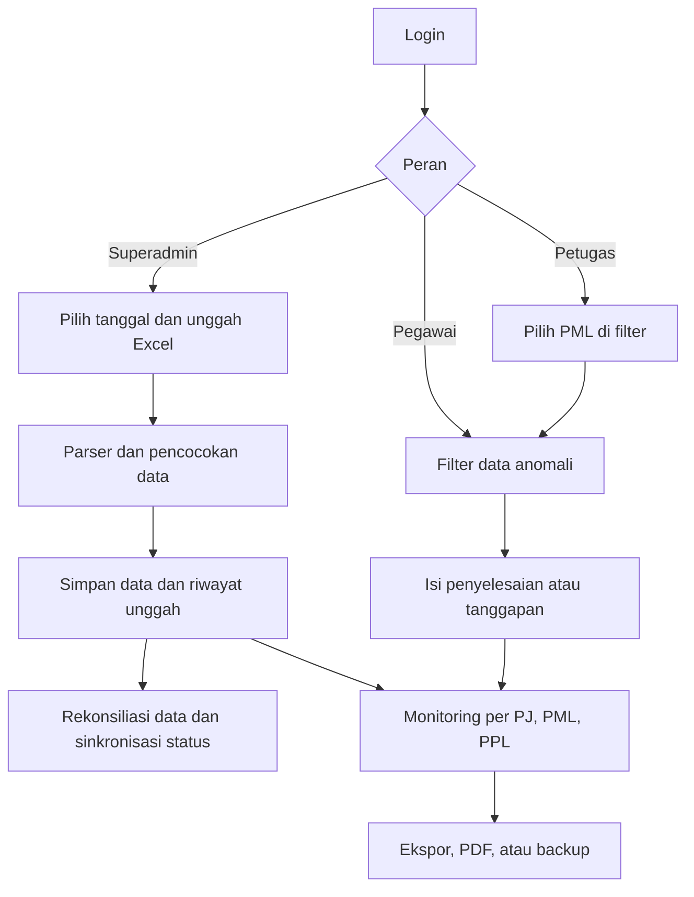

# Sistem Anomali Sensus

## 1. Judul dan deskripsi singkat project

Aplikasi web berbasis Laravel untuk mengimpor, memantau, dan mengelola tindak lanjut data anomali sensus dari file Excel FASIH. Aplikasi menyediakan akses berbeda untuk superadmin, pegawai, dan petugas.

## 2. Latar belakang dan masalah yang diselesaikan

Data anomali diterima sebagai file Excel dan dapat mencakup banyak entitas, wilayah, serta jenis anomali. Tanpa pencatatan terpusat, pembaruan data antarunggahan, pembagian tanggung jawab, status tindak lanjut, dan rekap progres sulit dilacak.

Aplikasi ini menyimpan hasil impor di basis data, mempertahankan riwayat unggahan, menyediakan formulir tindak lanjut, dan menyajikan rekap berdasarkan penugasan PML/PPL/PJ. Implementasi parser menunjukkan dukungan terhadap format file FASIH gabungan dan format lama yang memisahkan data usaha dan keluarga.

## 3. Pengguna target

- **Superadmin**: mengelola akun dan data referensi, mengunggah atau mengimpor data, melihat rekap, serta membuat dan memulihkan backup.
- **Pegawai**: memeriksa data anomali, memperbarui status penyelesaian, dan melihat progres per PJ.
- **Petugas**: memilih PML yang sedang dikerjakan, melihat dan memfilter data, lalu mengisi tanggapan petugas.
- **PML/PPL/PJ**: merupakan kategori atau entitas penugasan yang dipakai dalam referensi dan rekap. Kode aplikasi tidak mendefinisikan PML, PPL, dan PJ sebagai tiga peran akun terpisah.

## 4. Fitur

1. **Autentikasi dan profil** — login, logout, registrasi umum, verifikasi email, reset dan konfirmasi kata sandi, serta pengelolaan profil.
2. **Hak akses berbasis peran** — middleware membatasi rute untuk `superadmin`, `pegawai`, dan `petugas`; akun nonaktif ditolak saat login.
3. **Impor Excel FASIH** — mendukung file gabungan usaha/keluarga dan format lama dua file terpisah. File gabungan secara eksplisit menerima referensi PML/PPL/nama SLS opsional; perilaku file referensi pada format lama perlu dikonfirmasi.
4. **Impor gabungan bertahap** — memproses file besar dalam beberapa permintaan agar pemrosesan tidak bergantung pada satu permintaan panjang.
5. **Pencocokan dan rekonsiliasi data** — parser memecah segmen anomali, mencocokkan data antarunggahan, menghitung data baru/diperbarui, menandai data yang tidak muncul lagi, dan menyimpan ringkasan unggahan.
6. **Impor pekerjaan dari data lama** — mencoba mencocokkan file lama ke data tersimpan lalu mengisi kolom kerja yang relevan; hasil dan baris yang tidak cocok dapat dilihat di halaman hasil.
7. **Daftar dan tindak lanjut anomali** — filter pencarian, PML, PPL, periode unggah, kecamatan, desa, tindak lanjut, kategori anomali, dan status penyelesaian. Pegawai memperbarui penyelesaian; petugas mengisi tanggapan untuk PML yang dipilih.
8. **Ekspor Excel** — mengekspor data hasil filter dalam format yang dikelompokkan kembali per baris asal file Excel. Ekspor ini berbeda dari file backup lengkap.
9. **Monitoring progres** — rekap per PJ, PML, dan PPL, grafik/breakdown tindak lanjut, serta unduhan rekap PDF.
10. **Data penugasan PJ** — superadmin dapat mengimpor Excel penugasan; setiap impor menggantikan isi tabel penugasan sebelumnya.
11. **Manajemen akun** — membuat, mengubah kategori, mengaktifkan/nonaktifkan, dan menghapus akun pegawai/petugas.
12. **Riwayat unggah** — melihat ringkasan dan data terkait per unggahan; penghapusan riwayat dengan data kerja yang sudah dikerjakan memerlukan konfirmasi tambahan.
13. **Backup dan pemulihan** — mengunduh backup lengkap, memulihkan dari format backup aplikasi, melihat/mengunduh backup otomatis, serta menjalankan backup harian melalui scheduler Laravel.
14. **Sinkronisasi status penyelesaian** — setelah impor gabungan, status penyelesaian dapat diselaraskan dengan tindak lanjut FASIH untuk satu kelompok baris sekaligus. Tersedia pula perintah artisan untuk pemeriksaan atau eksekusi manual.

### Rute dan halaman utama

Rute berikut dibaca dari `routes/web.php` dan `routes/auth.php`. Akses selain autentikasi tetap mengikuti middleware peran yang dipasang pada rute.

| Area | Rute/halaman |
|---|---|
| Beranda dan akun | `/` (redirect ke login), `/login`, `/register`, `/dashboard`, `/profile`, `/password`, `/forgot-password`, `/reset-password/{token}`, `/verify-email`, `/confirm-password`, `/logout` |
| Data anomali | `/data-anomali`, `/data-anomali/{dataAnomali}/edit`, `/data-anomali/update-grup`, `/data-anomali/{dataAnomali}`, `/data-anomali/ekspor` |
| Unggah dan impor | `/unggah-excel`, `/unggah-excel-gabungan`, `/unggah-excel-gabungan/mulai`, `/unggah-excel-gabungan/proses`, `/unggah-excel-gabungan/selesai`, `/impor-data-lama`, `/impor-data-lama/hasil` |
| Monitoring | `/monitoring`, `/monitoring/progress-petugas`, `/monitoring/progress-pegawai`, `/monitoring-tindak-lanjut/per-pj`, `/monitoring-tindak-lanjut/per-pml`, `/monitoring-tindak-lanjut/per-ppl`, `/monitoring-tindak-lanjut/grafik`; tiap rekap PJ/PML/PPL memiliki rute unduhan PDF |
| Akun dan riwayat | `/kelola-pegawai` dan `/kelola-petugas` (termasuk aksi akun), `/riwayat-unggah`, `/riwayat-unggah/{riwayatUnggah}` |
| Backup dan restore | `/backup`, `/restore`, `/backup-otomatis`, `/backup-otomatis/{namaFile}`, `/cron/backup-otomatis/{token}` |

Rute tambahan untuk unggah penugasan PJ adalah `/monitoring-tindak-lanjut/unggah-pj`. Route `/perbaiki-sinkron-sekali-pakai` juga ada di dalam kelompok superadmin dan menjalankan perbaikan data satu kali; gunakan hanya setelah memahami dampaknya. Rute unggah referensi mandiri tidak aktif karena deklarasinya dikomentari.

## 5. Alur kerja aplikasi

1. Pengguna masuk dan diarahkan ke fitur sesuai perannya.
2. Superadmin memilih tanggal data, lalu mengunggah file FASIH. Pada format gabungan, file referensi PML/PPL/nama SLS opsional; jika tidak disertakan, aplikasi menggunakan referensi yang sudah tersimpan.
3. Parser membaca header dan data Excel. File gabungan dapat diproses sekaligus atau bertahap; format lama diproses dari dua file terpisah.
4. Baris Excel dan segmen anomalinya disimpan sebagai data terstruktur. Referensi wilayah dipakai untuk mengisi PML, PPL, dan nama SLS bila cocok.
5. Aplikasi mencatat ringkasan unggahan, memperbarui data yang cocok, menandai data aktif yang tidak muncul pada unggahan terbaru, dan menjalankan sinkronisasi status yang tersedia.
6. Pegawai memfilter data dan mengisi status penyelesaian. Petugas memilih PML pada filter, kemudian mengisi tanggapan untuk data dalam lingkup PML tersebut.
7. Pengguna yang berwenang memeriksa monitoring, mengunduh rekap/ekspor, atau membuat backup.



## 6. Teknologi dan library

- **PHP `^8.3`**, **Laravel `^13.8`**, dan Eloquent ORM.
- **PhpSpreadsheet** untuk membaca dan menulis Excel; mode impor bertahap juga menggunakan `XMLReader` dan `ZipArchive`.
- **barryvdh/laravel-dompdf** untuk rekap PDF.
- **doctrine/dbal** sebagai dependensi database.
- **Vite**, **Tailwind CSS**, **Alpine.js**, **Chart.js**, dan **chartjs-plugin-datalabels** untuk aset antarmuka dan grafik.
- **PHPUnit `^12.5`** untuk pengujian; Laravel Breeze dipakai sebagai dasar fitur autentikasi.
- Database default pada konfigurasi adalah **SQLite**; konfigurasi Laravel juga menyediakan driver MySQL/MariaDB, PostgreSQL, dan SQL Server.

Versi di atas mengikuti rentang dependensi pada `composer.json` dan `package.json`, bukan hasil verifikasi versi runtime pada server.

## 7. Struktur folder dan berkas penting

```text
app/
  Console/Commands/       Perintah backup dan sinkronisasi status.
  Http/Controllers/       Controller fitur, autentikasi, impor, monitoring, dan akun.
    Auth/                 Controller autentikasi.
    Concerns/             Logika rekap yang dipakai bersama.
  Http/Middleware/        Pemeriksaan peran dan middleware petugas.
  Models/                 Model User, DataAnomali, RiwayatUnggah,
                          ReferensiPplPml, dan PenugasanPj.
  Services/               Parser Excel, backup/restore, dan sinkronisasi.
  Providers/              Provider aplikasi.
  View/Components/        Komponen layout Blade.
bootstrap/
  app.php                 Pendaftaran rute, middleware, dan penanganan exception.
config/                   Konfigurasi aplikasi, database, auth, mail, storage,
                          session, queue, cache, logging, dan layanan.
database/
  migrations/             Skema dan perubahan skema database.
  seeders/                Seeder data awal, termasuk seeder superadmin.
  factories/               Factory untuk model User.
public/                   Front controller dan aset publik/build.
resources/
  css/ dan js/            Sumber aset frontend.
  views/                  Halaman Blade untuk auth, dashboard, anomali,
                          monitoring, akun, riwayat, dan backup.
routes/
  web.php                 Rute aplikasi berbasis web dan pembatasan peran.
  auth.php                Rute autentikasi.
  console.php             Perintah Artisan dan jadwal tugas.
storage/                  Berkas runtime, unggahan sementara, log, dan backup.
tests/
  Feature/ dan Unit/      Pengujian PHPUnit.
artisan                   CLI Laravel.
composer.json             Dependensi dan skrip Composer.
package.json              Dependensi dan skrip frontend.
vite.config.js            Konfigurasi bundler frontend.
tailwind.config.js        Konfigurasi Tailwind.
postcss.config.js         Konfigurasi PostCSS.
phpunit.xml               Konfigurasi suite pengujian.
.env.example              Template nama konfigurasi lingkungan; tidak memuat
                          konfigurasi rahasia aktual.
```

Berkas domain yang paling penting:

- `app/Http/Controllers/DataAnomaliController.php` — daftar, filter, ekspor, dan pembaruan data anomali.
- `app/Http/Controllers/UnggahExcelController.php` dan `UnggahBertahapController.php` — endpoint impor.
- `app/Services/PemrosesExcelAnomali.php`, `PemrosesExcelAnomaliGabungan.php`, dan `PemrosesExcelAnomaliBertahap.php` — parser dan rekonsiliasi file.
- `app/Http/Controllers/MonitoringTindakLanjutController.php` dan `app/Http/Controllers/Concerns/HitungRekapPj.php` — rekap, grafik, PDF, dan penugasan.
- `app/Services/PembuatBackupAnomali.php` dan `RestoreBackupAnomali.php` — format backup dan pemulihan.
- `routes/web.php` — daftar rute aktif dan kelompok hak akses.

## 8. Skema database / data model

Skema final dibentuk oleh rangkaian migrasi di `database/migrations/`; beberapa kolom dan kunci unik berubah melalui migrasi lanjutan.

| Tabel | Fungsi dan hubungan utama |
|---|---|
| `users` | Akun, nama/email/kata sandi, peran (`superadmin`, `pegawai`, `petugas`), kategori petugas (`pml`/`ppl`), dan status aktif. Riwayat unggah mengacu ke pengguna pengunggah. |
| `data_anomali` | Data tiap anomali, assignment, kategori usaha/keluarga, lokasi, entitas, tautan FASIH, tindak lanjut FASIH, PML/PPL/SLS, status kerja, tanggapan, tanggal respons, data spesifik JSON, dan identitas pengubah. `kelompok_baris_excel` menandai baris asal Excel; beberapa anomali dalam satu baris dapat tersimpan sebagai beberapa record. |
| `riwayat_unggah` | Pengunggah, tanggal data, nama file, jumlah data baru/diperbarui/tidak muncul, total dan breakdown tindak lanjut. Berelasi ke `users`; `data_anomali.riwayat_unggah_id` mengacu ke riwayat terkait. |
| `referensi_ppl_pml` | Pemetaan `idsubsls` ke PML, PPL, dan nama SLS untuk proses impor. |
| `penugasan_pj` | Pemetaan PML dan kecamatan ke PJ; isi tabel diganti saat file penugasan baru diimpor. |
| Tabel bawaan Laravel | Migrasi juga membuat tabel pengguna untuk reset kata sandi dan sesi, cache, serta antrean pekerjaan. |

Kunci unik `data_anomali` mengalami beberapa perubahan pada migrasi. Karena itu, kunci identifikasi data sebaiknya dibaca dari seluruh rangkaian migrasi dan layanan impor, bukan diasumsikan hanya `assignment_id`.

## 9. Instalasi dan menjalankan project

Prasyarat: PHP 8.3 atau lebih baru sesuai batas Composer, Composer, Node.js/npm, serta ekstensi PHP yang dibutuhkan Laravel dan PhpSpreadsheet (termasuk `XMLReader` dan `ZipArchive` untuk impor bertahap).

1. Buka direktori project di terminal.
2. Jalankan skrip setup yang didefinisikan di `composer.json`:

   ```bash
   composer setup
   ```

   Skrip tersebut memasang dependensi Composer, membuat `.env` dari `.env.example` jika belum ada, membuat application key, menjalankan migrasi, memasang dependensi npm, dan membangun aset frontend.
3. Atur koneksi database dan konfigurasi runtime sesuai lingkungan. Konfigurasi default database adalah SQLite.
4. Jika membutuhkan akun awal dari seeder, tinjau dan ubah kredensial yang didefinisikan dalam `database/seeders/SuperadminSeeder.php` sebelum menjalankan:

   ```bash
   php artisan db:seed
   ```

   Seeder bukan bagian dari skrip `composer setup`. Jangan gunakan kredensial statis dari source code di lingkungan produksi.
5. Jalankan lingkungan pengembangan:

   ```bash
   composer run dev
   ```

   Skrip ini menjalankan server Laravel, listener antrean, log viewer, dan Vite secara bersamaan. Untuk menjalankan hanya build frontend: `npm run build`.
6. Jalankan pengujian:

   ```bash
   composer test
   ```

   atau `php artisan test`.

Backup otomatis dijadwalkan harian melalui Laravel Scheduler. Lingkungan deployment perlu menjalankan scheduler Laravel secara berkala; definisi jadwal ada di `routes/console.php`, tetapi konfigurasi cron pada server tidak disediakan oleh repository.

## 10. Variabel environment

Nama berikut dirangkum dari `.env.example` dan pemanggilan konfigurasi aplikasi. Nilai tidak dicantumkan. Tidak semua variabel diperlukan sekaligus; sebagian hanya berlaku untuk driver atau layanan yang dipilih.

**Konfigurasi inti:**

`APP_NAME`, `APP_ENV`, `APP_KEY`, `APP_DEBUG`, `APP_URL`, `DB_CONNECTION`, `DB_URL`, `DB_DATABASE`, `SESSION_DRIVER`, `CACHE_STORE`, `QUEUE_CONNECTION`, `FILESYSTEM_DISK`, `MAIL_MAILER`.

**Database, session, logging, dan runtime (sesuai konfigurasi yang dipakai):**

`DB_HOST`, `DB_PORT`, `DB_USERNAME`, `DB_PASSWORD`, `DB_SOCKET`, `DB_CHARSET`, `DB_COLLATION`, `DB_FOREIGN_KEYS`, `DB_SSLMODE`, `MYSQL_ATTR_SSL_CA`, `APP_LOCALE`, `APP_FALLBACK_LOCALE`, `APP_FAKER_LOCALE`, `APP_MAINTENANCE_DRIVER`, `BCRYPT_ROUNDS`, `LOG_CHANNEL`, `LOG_STACK`, `LOG_DEPRECATIONS_CHANNEL`, `LOG_DEPRECATIONS_TRACE`, `LOG_LEVEL`, `SESSION_LIFETIME`, `SESSION_ENCRYPT`, `SESSION_PATH`, `SESSION_DOMAIN`, `BROADCAST_CONNECTION`.

**Integrasi opsional:**

`MEMCACHED_HOST`, `REDIS_CLIENT`, `REDIS_CLUSTER`, `REDIS_PERSISTENT`, `REDIS_URL`, `REDIS_HOST`, `REDIS_USERNAME`, `REDIS_PASSWORD`, `REDIS_PORT`, `REDIS_DB`, `REDIS_CACHE_DB`, `REDIS_PREFIX`, `REDIS_MAX_RETRIES`, `REDIS_BACKOFF_ALGORITHM`, `REDIS_BACKOFF_BASE`, `REDIS_BACKOFF_CAP`, `MAIL_SCHEME`, `MAIL_HOST`, `MAIL_PORT`, `MAIL_USERNAME`, `MAIL_PASSWORD`, `MAIL_FROM_ADDRESS`, `MAIL_FROM_NAME`, `POSTMARK_API_KEY`, `RESEND_API_KEY`, `AWS_ACCESS_KEY_ID`, `AWS_SECRET_ACCESS_KEY`, `AWS_DEFAULT_REGION`, `AWS_BUCKET`, `AWS_USE_PATH_STYLE_ENDPOINT`, `SLACK_BOT_USER_OAUTH_TOKEN`, `SLACK_BOT_USER_DEFAULT_CHANNEL`, `VITE_APP_NAME`.

**Endpoint backup otomatis melalui layanan cron eksternal:**

`BACKUP_CRON_TOKEN` — dipakai oleh konfigurasi endpoint backup HTTP. Nama ini digunakan kode tetapi tidak tercantum di `.env.example`.

## 11. Status project

Penilaian ini berdasarkan rute, controller, service, view, migrasi, dan test yang tersedia; bukan hasil uji penerimaan seluruh proses bisnis.

- **Sudah diimplementasikan di kode:** autentikasi dasar dan profil; peran akun; dua format impor; impor gabungan bertahap; daftar dan pembaruan anomali; riwayat unggah; manajemen akun; rekap/grafik/PDF; ekspor Excel; backup/restore; dan perintah backup/sinkronisasi.
- **Belum terverifikasi secara memadai:** alur bisnis utama impor, tindak lanjut, rekap, dan backup tidak memiliki test khusus yang tampak pada direktori `tests/`. Test yang tersedia terutama test contoh, autentikasi, dan profil. Ini tidak membuktikan fitur gagal, tetapi cakupan otomatisnya terbatas.
- **Tidak tersedia sebagai rute aktif:** route unggah referensi mandiri dikomentari di `routes/web.php`; pembaruan referensi masih tersedia sebagai bagian opsional dari proses unggah Excel.
- **Belum dapat ditentukan:** repository tidak memuat daftar backlog atau kriteria penerimaan, sehingga pekerjaan yang memang direncanakan tetapi belum dibuat tidak dapat diidentifikasi hanya dari kode.

## 12. Perlu konfirmasi

1. Apakah registrasi publik memang diharapkan? Rute `register` memakai `RegisteredUserController`, sedangkan `RegistrasiPetugasController` yang memvalidasi nama terhadap data PML tidak terhubung di `routes/auth.php`.
2. Apakah fitur unggah referensi mandiri sengaja dinonaktifkan? Controller `UnggahReferensiController` ada, tetapi route-nya dikomentari; referensi juga bisa diunggah bersama file anomali.
3. Pada format lama, apakah file referensi memang wajib? Controller mengizinkannya kosong, tetapi service lama memiliki parameter wajib dan memproses referensi tanpa pengecekan null.
4. Apakah deployment telah mengatur Laravel Scheduler? Kode menjadwalkan backup harian, tetapi pemanggil scheduler di server tidak didefinisikan di repository.
5. Apakah `BACKUP_CRON_TOKEN` akan dipakai untuk layanan cron eksternal? Kode menggunakannya, tetapi variabel itu tidak ada di `.env.example`.
6. Apakah backup yang hanya disimpan di server yang sama sudah memenuhi kebijakan pemulihan? Kode menyimpan backup otomatis secara lokal dan menghapus yang lebih lama dari 14 hari; salinan off-site tidak diatur oleh aplikasi.
7. Apakah format/header file Excel dari pusat dan file impor data lama yang dipakai saat ini sudah sesuai dengan asumsi parser? Implementasi menetapkan posisi header tertentu dan beberapa nama kolom sebagai acuan.
8. Apakah tersedia lingkungan database atau data awal resmi untuk pengujian end-to-end? File database lokal dan berkas runtime tidak dijadikan dasar dokumentasi ini.
